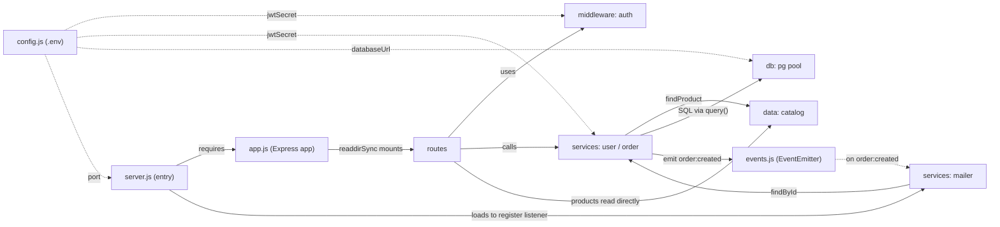
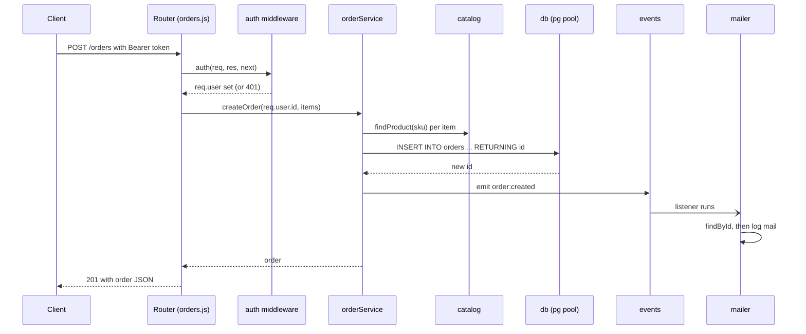

# mini-shop architecture

> Based on: b430ebb
> [Overview](00_overview.md)

## At a glance
mini-shop is one Node.js process with an Express app built in `src/app.js` and started by `src/server.js` (`src/app.js:5-14`, `src/server.js:5-7`).
Requests pass through three layers: routes (HTTP parsing and responses), services (business rules) and db (a pg pool) (`src/routes/orders.js:7-14`, `src/services/orderService.js:16-19`, `src/db/index.js:4-8`).
Two shared pieces sit beside the layers: an in-memory product catalog and a process-wide `EventEmitter` that lets services react to each other without imports (`src/data/catalog.js:2595-2598`, `src/events.js:3-4`).
All settings come from environment variables read once in `src/config.js` (`src/config.js:1-7`).

## Layers
- **Entry and wiring**: [_root](02_modules/_root.md). `src/server.js` starts the listener and loads the mailer; `src/app.js` adds JSON body parsing, mounts every router file and installs the global error handler (`src/server.js:1-7`, `src/app.js:6-12`).
- **HTTP layer**: [routes](02_modules/routes.md), with [middleware](02_modules/middleware.md) placed in front of protected handlers. The orders and users routers only read the request, call a service and shape the response, passing errors to `next` (`src/routes/orders.js:7-22`, `src/routes/users.js:6-13`); the products router is the exception, reading the catalog directly and sending its own 404 without `next` (`src/routes/products.js:2-14`).
- **Business layer**: [services](02_modules/services.md). Services throw errors carrying an HTTP `status` (400 for an unknown SKU, 401 for bad credentials), which the global handler turns into the response code (`src/services/orderService.js:10-12`, `src/services/userService.js:9-11`, `src/app.js:10-12`).
- **Data layer**: [db](02_modules/db.md) for Postgres and [data](02_modules/data.md) for the read-only product catalog (`src/db/index.js:6-8`, `src/data/catalog.js:2598`).

Assumption: the split keeps HTTP concerns out of the services so that they can be tested without Express; the only test calls `createOrder` directly with a stubbed db (`test/orderService.test.js:6-16`).

## Dependencies between modules

Dotted edges are hidden connections (event subscription and config values).

- `app.js` to routes: there is no `require` of a router by name; every file in `src/routes` is mounted by a directory scan, so a new file there becomes live automatically (`src/app.js:8`).
- server to mailer: `src/server.js` requires the mailer only for its side effect of registering the `order:created` listener (`src/server.js:3`, `src/services/mailer.js:9-12`).
- services to events to mailer: `orderService` emits `order:created` after storing the order, and the mailer reacts to it; the bus exists so services do not import each other (`src/services/orderService.js:20-21`, `src/events.js:3-4`).
- routes to catalog: the products router reads the catalog directly instead of going through a service (`src/routes/products.js:2`).
- config to everything: the JWT secret is shared by token signing and verification, and the database URL feeds the pool (`src/services/userService.js:13`, `src/middleware/auth.js:9`, `src/db/index.js:4`).

## Request and data flow
Representative request: `POST /orders` (create an order).

1. Express parses the JSON body and the router matches `POST /orders` (`src/app.js:6`, `src/routes/orders.js:7`).
2. `auth` takes the Bearer token, verifies it with `JWT_SECRET` and stores the payload in `req.user`, or answers 401 (`src/middleware/auth.js:5-13`).
3. The router calls `createOrder` with the user id and `req.body.items` (`src/routes/orders.js:9`).
4. Each item is priced from the catalog; an unknown SKU throws an error with status 400 (`src/services/orderService.js:7-15`).
5. The order is inserted into `orders` with the items as JSON, and the new id is returned (`src/services/orderService.js:16-20`, `db/001_init.sql:7-13`).
6. `order:created` is emitted; the mailer looks up the user and logs a confirmation mail (`src/services/orderService.js:21`, `src/services/mailer.js:9-12`).
7. The router answers 201 with the order; any thrown error goes to the global handler, which uses `err.status` or 500 (`src/routes/orders.js:10-13`, `src/app.js:10-12`).

No `04_flows/` docs exist yet.

## Configuration and external connections
- Environment variables are read only in `src/config.js`, after `dotenv` loads `.env` (`src/config.js:1-7`, `.env`):
  - `PORT` (default 3000) for the HTTP listener (`src/config.js:4`, `src/server.js:5`).
  - `JWT_SECRET` for token signing and verification (`src/config.js:5`, `src/services/userService.js:13`, `src/middleware/auth.js:9`).
  - `DATABASE_URL` for the pg pool (`src/config.js:6`, `src/db/index.js:4`).
- PostgreSQL is the only external system; its schema is in `db/001_init.sql` (`db/001_init.sql:1-13`).
- Mail is not an external connection: `send` only writes to the console (`src/services/mailer.js:4-7`).
- The product catalog is not in the database; it is a generated JS file from `tools/gen-catalog`, which is not in the repo (`src/data/catalog.js:1`).

## Watch out when reading
- **Implicit route mounting**: any file placed in `src/routes` is `require`d and mounted, including non-router files, so that folder must contain only routers (`src/app.js:8`).
- **Listener depends on the entry point**: the mailer listener is registered only because `src/server.js` requires it; code that uses `src/app.js` alone (for example a test) gets no mail side effect (`src/server.js:3`, `src/app.js:14`).
- **Async listener errors are not handled**: the `order:created` listener is an `async` function with no `try/catch`, so a db failure in `findById` becomes an unhandled promise rejection rather than an HTTP error (`src/services/mailer.js:9-12`).
- **Plaintext passwords**: `login` compares the stored password to the input with `!==`, and the `users.password` column is plain `TEXT`, so passwords are not hashed (`src/services/userService.js:8`, `db/001_init.sql:4`).
- **Layer shortcut**: the products router reads the catalog directly, skipping the service layer (`src/routes/products.js:2-13`).
- **Schema coupled by convention**: services send raw SQL strings and nothing checks them against `db/001_init.sql` or applies it (`src/services/orderService.js:17`, `src/services/userService.js:6`, `db/001_init.sql:1-13`).
- **Generated file**: `src/data/catalog.js` is about 2,600 lines and marked "Do not edit by hand" (`src/data/catalog.js:1`).
- **Test stubbing via module cache**: the test writes into `Module._cache` before loading `orderService`, so require order matters there (`test/orderService.test.js:6-11`).
- `userService.findById` has no route; its only caller is the mailer (`src/services/userService.js:16-19`, `src/services/mailer.js:10`).
